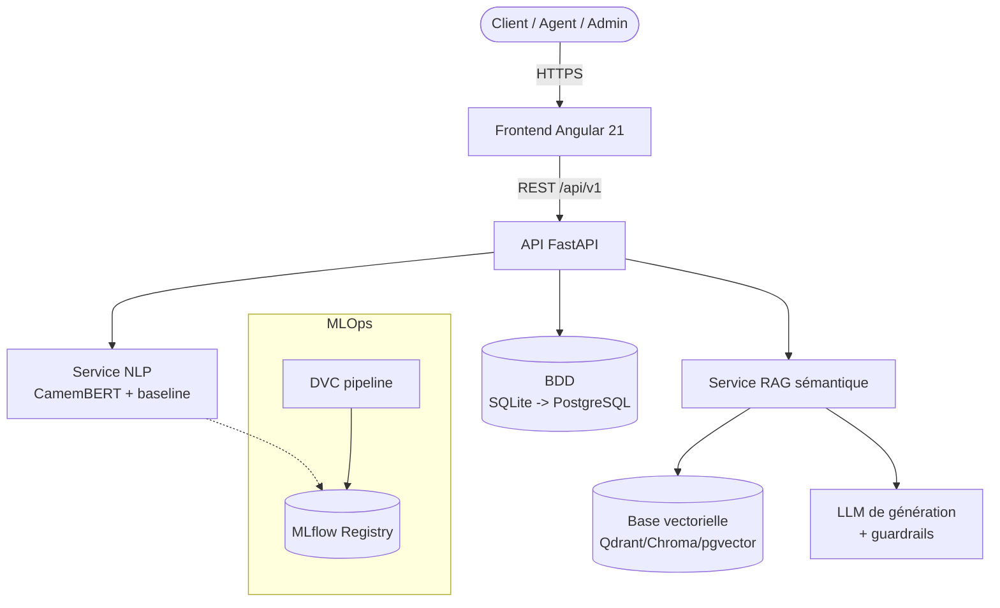
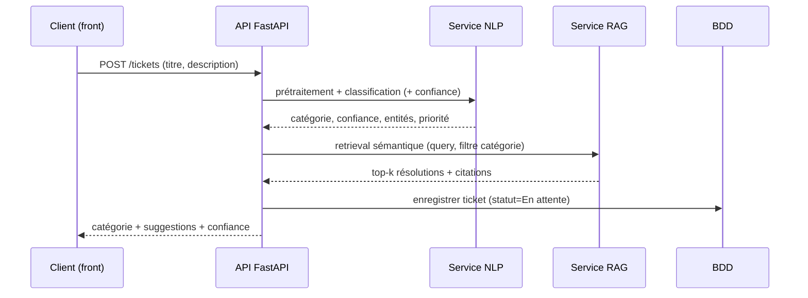
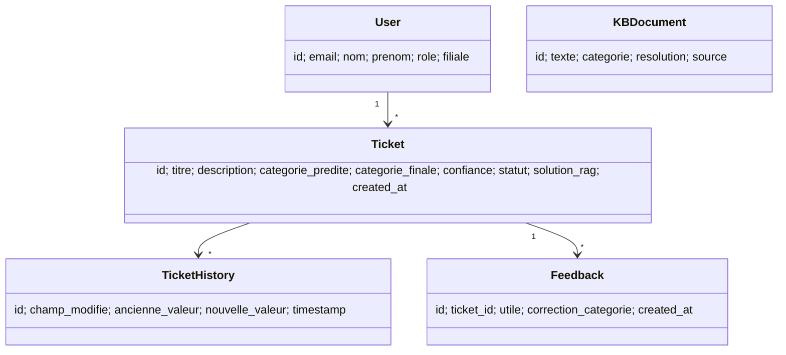

# ARCHITECTURE.md — Architecture détaillée

> Vue de référence (évolutive). Résumé dans [PLAN.md](PLAN.md) (section 3). Décisions dans
> [DECISIONS.md](DECISIONS.md). Dernière mise à jour : *à la création*.

## 1. Vue d'ensemble (C4 — niveau Conteneurs)

## 2. Modules

| Module | Responsabilité | État | Emplacement cible |
|---|---|---|---|
| Frontend | UI client/admin, restitution confiance + sources, feedback | 🟡 | `frontend/` |
| API | Contrat REST, auth, orchestration | ✅🟡 | `api/` |
| Service NLP | Classification, résumé, NER, priorité, sentiment | ✅🔴 | `api/services/ai_service.py`, `src/models/` |
| Service RAG | Retrieval sémantique + génération | 🔴 | `src/rag/` (à refondre) |
| Base vectorielle | Index des embeddings | 🔴 | infra |
| BDD | Tickets, users, historique, feedback | ✅ | `api/db/` |
| MLOps | Reproductibilité, registre | 🔴 | `dvc.yaml`, `mlruns/` |
| Sécurité | JWT, RBAC, secrets | 🟡 | `api/services/auth_service.py`, middleware |

## 3. Flux de données (création d'un ticket)

## 4. Modèle de données (domaine)

> `Feedback` et `KBDocument` sont **cibles** (à introduire en Phases 9 et 6).

## 5. Stack technique

| Couche | Technologies |
|---|---|
| Frontend | Angular 21, Angular Material, Chart.js, RxJS |
| API | FastAPI, Pydantic v2, Uvicorn |
| NLP/ML | scikit-learn, imbalanced-learn, NLTK, HuggingFace Transformers, PEFT/LoRA |
| RAG | sentence-transformers (FR), base vectorielle (ADR-004), RAGAS |
| Données | pandas, DVC |
| MLOps | DVC, MLflow |
| Persistance | SQLAlchemy, SQLite → PostgreSQL |
| Sécurité | python-jose (JWT), passlib/bcrypt |
| Déploiement | Docker, docker-compose, GitHub Actions |

## 6. Principes d'architecture
- **Monolithe modulaire** (pas de microservices pour le PFE — voir ADR-005).
- Séparation en couches : `routers` (HTTP) → `services` (métier) → `repositories` (données).
- Sans état côté API (scalabilité horizontale possible).
- Dégradation gracieuse : si le LLM est indisponible, repli sur retrieval sans génération.
