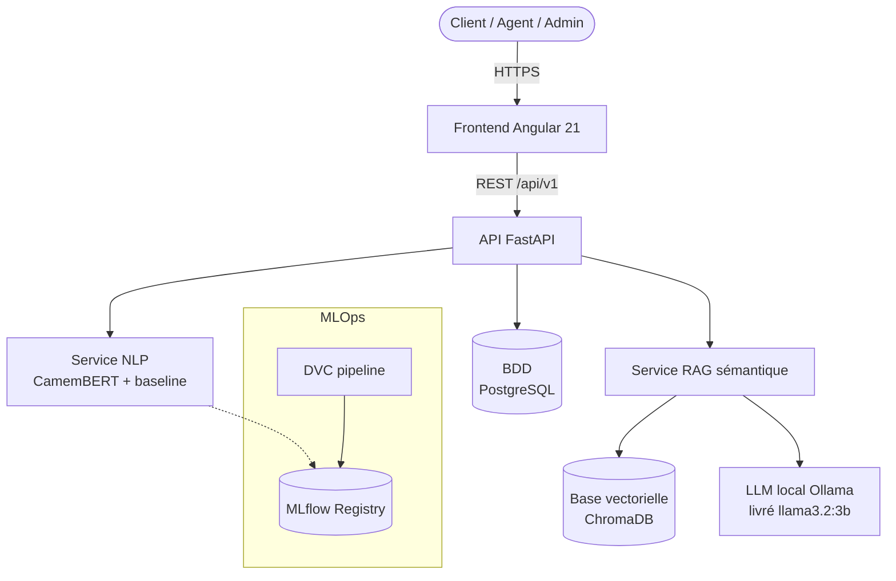
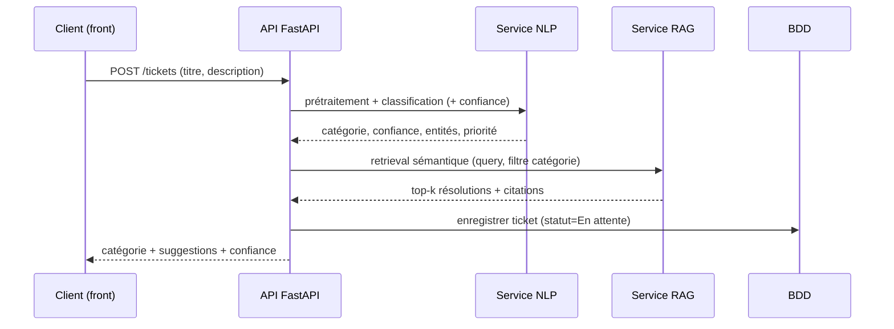
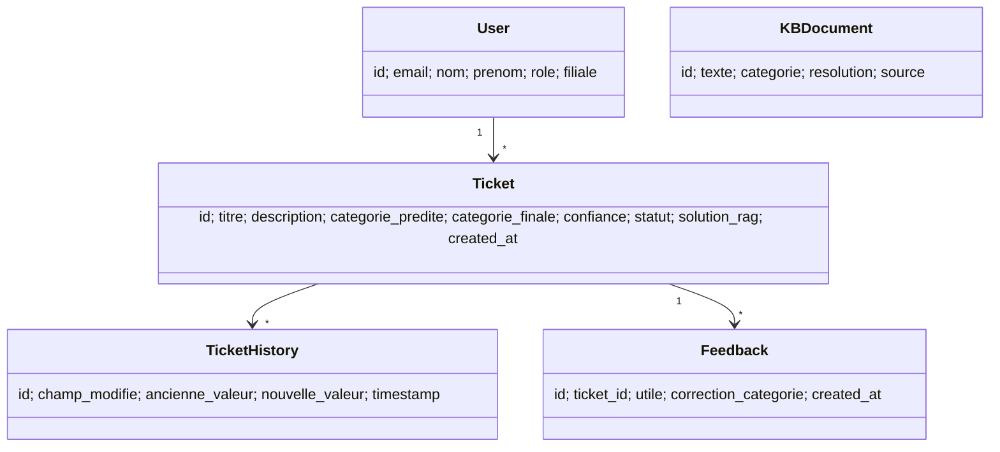

# ARCHITECTURE.md — Architecture détaillée

> Vue de référence (évolutive). Résumé dans [PLAN.md](PLAN.md) (section 3). Décisions dans
> [DECISIONS.md](DECISIONS.md). Chaîne MLOps détaillée dans [MLOPS.md](MLOPS.md).
> Dernière mise à jour : **2026-09-08** (mise à niveau après l'industrialisation MLOps du
> 2026-08-22 : le module MLOps n'était plus à l'état de projet).
>
> **Ce document sert de source au chapitre 6 du mémoire** (conception de l'application) et à la
> partie infrastructure du chapitre 7. Les diagrammes Mermaid ci-dessous sont à reproduire en
> figures LaTeX — voir [PFE_PROGRESS.md](PFE_PROGRESS.md) §4.

## 1. Vue d'ensemble (C4 — niveau Conteneurs)

## 2. Modules

| Module | Responsabilité | État | Emplacement cible |
|---|---|---|---|
| Frontend | UI client/admin, restitution confiance + sources, feedback | 🟡 | `frontend/` |
| API | Contrat REST, auth, orchestration | ✅🟡 | `api/` |
| Service NLP | Classification, résumé, NER, priorité, sentiment | ✅🔴 | `api/services/ai_service.py`, `src/models/` |
| Service RAG | Retrieval sémantique | ✅ | `src/rag/`, `api/services/ai_service.py` |
| Assistant de triage IA | Synthèse LLM des cas similaires (human-in-the-loop) | ✅ | `api/services/llm_service.py`, service Docker `ollama` |
| Base vectorielle | Index des embeddings (ChromaDB) | ✅ | `api/db/vector_store.py` |
| BDD | Tickets, users, historique, feedback | ✅ | `api/db/` |
| MLOps — pipeline | Reproductibilité de bout en bout, **8 stages** | ✅ | `dvc.yaml`, `params.yaml`, `mlruns/` |
| MLOps — registre de modèles | Versions, alias `production`, lignage, rollback | ✅ | `src/registry/model_registry.py`, `models/registry/` |
| MLOps — collecte | Tickets validés depuis PostgreSQL, qualification de la force de l'étiquette | ✅ | `src/pipeline/collect.py` |
| MLOps — dataset versionné | Fusion, empreinte SHA-256, garde-fous anti-fuite | ✅ | `src/pipeline/build_dataset.py` |
| MLOps — porte de promotion | Trois conditions, seul écrivain de `models/best_pipeline.pkl` | ✅ | `src/pipeline/promote.py` |
| MLOps — cycle de vie des connaissances | Contrôle qualité avant indexation, statuts, instantanés | ✅ | `src/knowledge/quality.py`, `src/knowledge/snapshot.py` |
| MLOps — supervision | Dérive du modèle et du corpus RAG | ✅ | `src/monitoring/ml_monitor.py`, `src/monitoring/rag_monitor.py` |
| Sécurité | JWT, RBAC, secrets | 🟡 | `api/services/auth_service.py`, middleware |

## 3. Flux de données (création d'un ticket)

## 4. Modèle de données (domaine)

> `Feedback` et `KBDocument` sont **cibles** (à introduire en Phases 9 et 6).

## 5. Stack technique

| Couche | Technologies |
|---|---|
| Frontend | Angular 21, Angular Material, Chart.js, RxJS |
| API | FastAPI, Pydantic v2, Uvicorn |
| NLP/ML | scikit-learn, imbalanced-learn, NLTK, HuggingFace Transformers, PEFT/LoRA |
| RAG | sentence-transformers (FR), ChromaDB (base vectorielle, ADR-004), RAGAS |
| LLM local | Ollama (`llama3.2:3b`, conteneur dédié, aucun appel externe) |
| Données | pandas, DVC |
| MLOps | DVC (8 stages), MLflow (`file:./mlruns`), registre de modèles maison (`src/registry/`) |
| Persistance | SQLAlchemy, PostgreSQL |
| Sécurité | python-jose (JWT), passlib/bcrypt |
| Déploiement | Docker, docker-compose, GitHub Actions |

## 6. Principes d'architecture
- **Monolithe modulaire** (pas de microservices pour le PFE — voir ADR-005).
- Séparation en couches : `routers` (HTTP) → `services` (métier) → `repositories` (données).
- Sans état côté API (scalabilité horizontale possible).
- Dégradation gracieuse : si le LLM est indisponible ou trop lent, repli sur un
  récapitulatif brut non reformulé plutôt que de faire échouer la requête (implémenté,
  `api/services/llm_service.py::_fallback_synthesis`).
