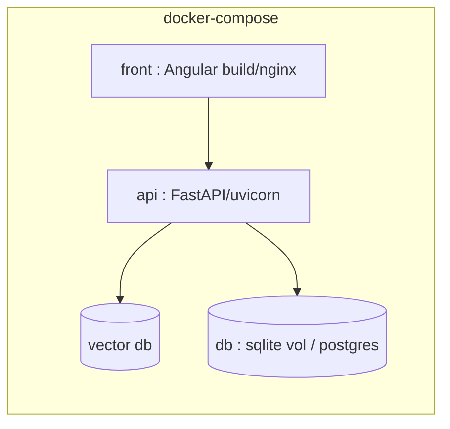

# DEPLOYMENT.md — Déploiement & infrastructure

> Squelette à enrichir (Phase 11). Source de vérité : [PLAN.md](PLAN.md). Décisions :
> [DECISIONS.md](DECISIONS.md). Dernière mise à jour : *à la création*.

## 1. Topologie cible (PFE)

> **Pas de Kubernetes** (ADR-005, hors périmètre). `docker-compose` suffit pour la démo et la
> soutenance.

## 2. Services & ports (cible)
| Service | Port | Description |
|---|---|---|
| `api` | 8000 | FastAPI (uvicorn) |
| `front` | 4200 / 80 | Angular (dev / build nginx) |
| `vector-db` | (selon ADR-004) | Base vectorielle |
| `db` | 5432 | PostgreSQL (cible) |

## 3. Conteneurisation
- [ ] `Dockerfile` API (multi-stage : deps → runtime)
- [ ] `Dockerfile` frontend (build Angular → nginx)
- [ ] `docker-compose.yml` (api + front + vector-db + db, volumes, réseau)
- [ ] Variables d'environnement via `.env` (jamais commitées)

## 4. CI/CD (GitHub Actions)
- [ ] Lint (ruff/flake8, eslint)
- [ ] Tests (pytest, vitest)
- [ ] Build images Docker
- [ ] Scan de sécurité d'image (trivy)
- [ ] Déploiement (cible à définir)

## 5. Configuration & secrets
- Secrets via variables d'environnement / secret manager (jamais en clair).
- Remplacer `SECRET_KEY=change-me` (cf. R-09).
- Séparer config dev / prod.

## 6. Observabilité
- [ ] Logs structurés (JSON)
- [ ] Métriques techniques (latence, erreurs) — Prometheus
- [ ] Métriques IA (distribution des confiances, taux de fallback RAG, hallucinations) — dashboard
- [ ] Healthchecks (`/health`)

## 7. Runbook (à compléter)
- Démarrage : `docker-compose up -d`
- Logs : `docker-compose logs -f api`
- Reprise / rollback : redéployer l'image précédente.
- Sauvegarde : volume BDD + index vectoriel.
